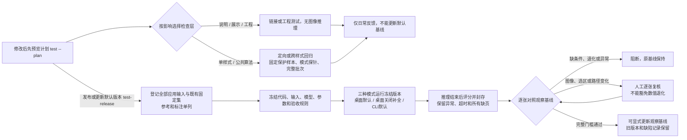
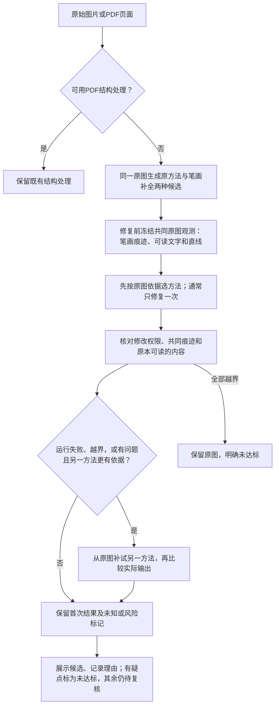

# 去水印处理流程图（持续更新）

- 文档版本：V1.22
- 最近核对日期：2026-10-30
- 适用范围：当前桌面程序的实际处理流程；命令行及流式处理的差异见文末。
- 本文件是处理流程的长期说明入口，后续直接维护此文件。它描述现有实现，不代表所有水印均已处理达标。

保留彩色原图，结合明暗、颜色和重复形状寻找水印，再选择适用的方法修复。灰度分析帮助比较深浅，不会把整套处理限定为灰度图；找水印和修复水印是两个独立步骤。

下图用日常说法归纳代码，部分相近分支合并展示。寻找方法按条件依次尝试，得到适用结果后通常就进入下一阶段；不同方法不是每张图都会全部运行。

配套实例：[单图去水印流程演示（2026-10-28 · V2）](单图去水印流程演示_20261028.html)。用一张建筑照片的真实桌面默认运行，查看实际原图、颜色增强输入、文字范围、最终选区、处理结果和实际修改位置。V2 移除了额外生成的灰度讲解图，六个环节只展示实际运行路径与结果核对；坐标蓝框、红色叠加和修改位置图明确标明为实际记录的可视化。图片与记录内置，支持离线查看、局部放大和前后对比。该实例是日期固定的开发样本记录；处理行为改变后应核对适用性，必要时用新目录重新运行并生成新版，不能把旧记录写成当前版本结果。

实例生成入口为 [tools/build_single_flow_demo.py](../tools/build_single_flow_demo.py)，讲解模板为 [tools/templates/single_flow_demo.html](../tools/templates/single_flow_demo.html)。通过 `--out 新目录 --html 新的HTML路径` 重新运行并生成；使用 `--render-only` 则仅从 `--out` 已存记录重新排版。生成器会检查本例实际定位和修复路径，路径变化时须更新讲解模板，不会默默套用旧说明。

## 完整流程图

```mermaid
flowchart TB

    subgraph S1["一、导入和设置"]
        A0["开始"] --> A1["导入图片或 PDF<br/>PDF 按页读取，图片保留彩色"]
        A1 --> A2["建立批次<br/>同批尽量放水印样式、位置相近的文件"]
        A2 --> A3["设置本批处理参数<br/>检测灵敏度、文字识别、修复范围等"]
        A3 --> A4["桌面默认开启<br/>文字识别＋补全水印笔画"]
        A4 --> A5["选择处理范围<br/>当前图片 / 当前批次 / 所有批次"]
        A5 --> A6["按图片尺寸分组<br/>为可能的多图辅助分析做准备"]
        A6 --> A7["取出当前要处理的一张"]
    end

    subgraph S2["二、先检查 PDF 能不能直接去掉水印"]
        B0{"这一页是否来自 PDF<br/>且原文件没有变化？"}
        B0 -->|"是"| B1["查看 PDF 内部的文字和图片对象<br/>判断水印是否独立叠在内容上面"]
        B1 --> B2{"找到符合条件的<br/>独立叠加对象了吗？"}
        B2 -->|"找到"| B3["只省略对应的显示指令<br/>不重画下面的正文和图片"]
        B3 --> B4["重新生成这一页的画面<br/>仍需复核是否删对"]
        B2 -->|"没有 / 不支持 / 检查失败"| B5["转为图片方式处理"]
        B0 -->|"普通图片 / 原文件不匹配"| B5
    end

    A7 --> B0

    subgraph S3["三、准备多图辅助信息"]
        C0{"同批同尺寸组里<br/>是否有多张图片？"}
        C0 -->|"有"| C1{"已有可复用的<br/>分析结果吗？"}
        C1 -->|"有"| C2["读取已保存的辅助信息"]
        C1 -->|"没有"| C3["比较多张图相同位置的内容<br/>寻找反复出现的淡色覆盖"]
        C3 --> C4["生成多图辅助判断<br/>页眉、表格等也可能重复，不能直接认作水印"]
        C3 -->|"计算异常"| C5["放弃本次多图辅助<br/>继续单张分析"]
        C0 -->|"只有一张"| C5
    end

    B5 --> C0

    subgraph S4["四、只根据当前图片，依次寻找适用的水印线索"]
        D0["开始分析当前彩色原图<br/>需要时计算灰度、色差和局部明暗"]
        D0 --> D1["按所选样式限制尝试范围<br/>未指定样式时，尝试自动判断"]

        D1 --> D2{"能验证规则小点<br/>或重复纹理吗？"}
        D2 -->|"能"| D2A["确认小点间距、位置和形状<br/>检查不同区域的表现是否一致"]
        D2 -->|"不能"| D3{"能识别角落编号<br/>或适用的深色大字吗？"}
        D3 -->|"能"| D3A["根据位置、形状和画面证据<br/>确定对应的水印区域"]

        D3 -->|"不能"| D4{"文字识别已开启吗？"}
        D4 -->|"关闭"| D11["进入通用明暗与颜色判断"]
        D4 -->|"开启"| D5["读取文字的位置、大小和倾斜方向<br/>同时帮助区分正文与水印"]

        D5 --> D6{"照片里有经过验证的<br/>重复字形或局部水印文字吗？"}
        D6 -->|"有"| D6A["比较图内重复字形<br/>确认实际可见的笔画和位置"]
        D6 -->|"没有"| DS0{"纸面正文中有大号彩色字<br/>和可核对的错位阴影吗？"}
        DS0 -->|"没有"| D7{"文档里有适用的<br/>重复文字水印吗？"}
        DS0 -->|"有"| DS1{"颜色与阴影叠加模型<br/>拟合收敛且未趋于不透明吗？"}
        DS1 -->|"通过配准和纸面核对"| DS2["按源图颜色及阴影证据选笔画<br/>保留字洞并记录分层还原结果"]
        DS1 -->|"不适用 / 验证失败"| DS3["沿用原阴影纸面清理<br/>记录不能反解的原因"]
        DS2 --> D19
        DS3 --> D19
        D7 -->|"有"| D7A["用较清楚的字形寻找其他重复位置<br/>检查正文交叠处和边缘残笔"]
        D7 -->|"没有"| D8{"能从纸面、正文和水印颜色<br/>判断透明叠加关系吗？"}
        D8 -->|"能"| D8A["估计水印的颜色和遮盖程度<br/>为后面的底色还原提供依据"]

        D8 -->|"不能"| D9{"还有明显的明暗或颜色线索吗？<br/>例如深色斜字、白色重复字、照片淡字"}
        D9 -->|"有"| D9A["从原图的局部明暗和色差中<br/>提取候选笔画"]
        D9 -->|"没有"| D10{"是否限定了水印样式？"}
        D10 -->|"是"| D14["该样式未找到有效选区"]
        D10 -->|"否"| D11

        D11 --> D12["必要时减轻 JPEG 方块干扰<br/>仅供定位使用，不替换原图"]
        D12 --> D13{"画面有足够的<br/>明亮纸面背景吗？"}
        D13 -->|"没有"| D14
        D13 -->|"有"| D15["估计纸张底色<br/>寻找反复出现的灰度深浅"]
        D15 --> D16["结合颜色、大小和形状判断<br/>避开识别到的正文、表格线等"]
        D16 --> D17{"形成候选选区了吗？"}
        D17 -->|"有"| D18["保留通用方法找到的候选结果<br/>估计不充分时标记低可信度"]
        D17 -->|"没有"| D14

        D2A --> D19["得到当前图片的初步水印选区<br/>以及适用的修复方式"]
        D3A --> D19
        D6A --> D19
        D7A --> D19
        D8A --> D19
        D9A --> D19
        D18 --> D19
    end

    C2 --> D0
    C4 --> D0
    C5 --> D0

    subgraph S5["五、补全笔画，并判断是否采用多图辅助结果"]
        E0{"开启补全笔画<br/>且当前路径适用吗？"}
        E0 -->|"否"| E5["保留原来的定位结果"]
        E0 -->|"是"| E1{"已有可信的透明度还原<br/>或规则小点处理结果吗？"}
        E1 -->|"有；包含已核对的阴影分层结果"| E5
        E1 -->|"没有"| E2["沿已发现的水印寻找淡笔画<br/>结合颜色、明暗或已验证的重复字形"]
        E2 --> E3["文字框和推测的重复行<br/>只用来确定在哪里继续找"]
        E3 --> E4["仅加入有画面证据的笔画像素<br/>保留字洞和字间空白"]
        E4 --> E5

        E5 --> E6{"多图辅助结果<br/>是否适合用于当前图片？"}
        E6 -->|"不适合 / 当前已有专门定位结果"| E7["使用当前图片自己的选区"]
        E6 -->|"适合"| E8["核对两者是否充分重合<br/>辅助选区是否异常变大"]
        E8 --> E9{"核对通过吗？"}
        E9 -->|"通过"| E10["采用多图辅助结果"]
        E9 -->|"不通过"| E7

        E7 --> E11["确定本次检测选区和修复路径<br/>检测范围与实际修复范围分别记录"]
        E10 --> E11
    end

    D19 --> E0

    subgraph S6["六、根据已确定的路径修复画面"]
        F0{"有实际选中的<br/>水印区域吗？"}
        F0 -->|"没有"| F1["保留原图<br/>记录未检测到水印"]
        F0 -->|"有"| F2["根据定位阶段的判断<br/>选择对应的清理办法"]

        F2 --> F3["透明覆盖可估计的水印"]
        F3 --> F3A["根据颜色和遮盖程度<br/>倒推被覆盖前的底色"]
        F3A --> F3B["在适用路径中保护正文和表格<br/>清理已确认区域里的纸面残影"]

        F2 --> F4["规则小点或重复纹理"]
        F4 --> F4A["按测得的叠加关系还原<br/>必要时局部清理小点内的颜色残影"]
        F4A --> F4B["尽量保留原来的亮度和纹理<br/>正文交叠处使用对应保护办法"]

        F2 --> F5["简单纸面、角标或重复字"]
        F5 --> F5A["按该路径估计的纸面底色清理<br/>保留路径能够识别的正常内容"]

        F2 --> FS["适用的彩色阴影文字"]
        FS --> FS1["使用本图已拟合的颜色与错位阴影模型<br/>仅在当前许可选区内写回反解结果"]
        FS1 --> F9

        F2 --> F6["照片中的细小笔画"]
        F6 --> F6A{"笔画足够细<br/>且周围有可用内容吗？"}
        F6A -->|"是"| F6B["用紧邻像素补齐<br/>适合较窄的缺口"]
        F6A -->|"否"| F7

        F2 --> F7["照片大字、较重遮挡<br/>或其他需要补图的区域"]
        F7 --> F7A["按用户设置决定是否外扩<br/>周围画面供补图参考"]
        F7A --> F7B["调用本地 AI 修复模型"]
        F7B --> F7C["小区域补边，大区域分块处理<br/>重叠处平滑拼接"]
        F7C --> F7D["只把允许修复的位置写回原图<br/>适用时再尝试恢复原图细节"]

        F2 --> F8["通用混合处理路径"]
        F8 --> F8A["先尝试还原透明覆盖<br/>无法直接还原的部分再考虑补图"]
        F8A --> F8B{"候选补图范围过大吗？"}
        F8B -->|"是"| F8C["保留直接还原结果<br/>降低可信度，提示复核"]
        F8B -->|"否"| F7

        F3B --> F9["得到当前图片的处理结果"]
        F4B --> F9
        F5A --> F9
        F6B --> F9
        F7D --> F9
        F8C --> F9
        F1 --> F9
    end

    E11 --> F0
    D14 --> F1

    subgraph S7["七、自动检查与队列更新"]
        G0["检查处理耗时<br/>以及选区周围是否出现异常改动"]
        G0 --> G1["能够估计时检查水印残留<br/>不能可靠估计的项目记为未评估"]
        G1 --> G2["普通桌面处理没有干净原图作答案<br/>无法自动证明正文、背景已完整恢复"]
        G2 --> G3["记录自动检查结果和待复核状态<br/>自动检查通过不等于水印全部去净"]
        G3 --> G4["更新当前图片的结果和进度<br/>整批运行同步显示已处理张数、总用时及平均用时"]
        G4 --> G5{"还有图片需要处理吗？"}
        G5 -->|"有"| G6{"收到暂停或停止请求吗？"}
        G6 -->|"暂停"| G7["在处理检查点等待继续"]
        G7 -->|"继续"| G8["取下一张"]
        G6 -->|"停止"| G9["结束当前队列<br/>保留已经完成的结果"]
        G6 -->|"没有"| G8
        G5 -->|"没有"| G9

        GX["某张图片处理异常<br/>例如模型缺失或文件出错"]
        GX --> GY["记录失败原因<br/>继续后面的图片"]
        GY --> G4
    end

    B4 --> G0
    F9 --> G0
    F7B -->|"模型加载或运行失败"| GX
    G8 --> A7

    subgraph S8["八、查看与导出"]
        H0["查看处理前后<br/>拖动分隔线对比，或切换单独视图"]
        H0 --> H1["查看水印选区<br/>核对是否漏选笔画或误选背景"]
        H1 --> H2["人工检查<br/>残留、正文损伤、表格断线、照片补图痕迹"]
        H2 --> HA0{"需要手动修正选区吗？"}
        HA0 -->|"否"| H3["选择导出范围<br/>当前图片 / 当前批次 / 所有批次"]
        HA0 -->|"是"| HA1["在原图上编辑完整水印选区<br/>缩放、平移、画笔局部放大镜"]
        HA1 --> HA2["画笔添加／擦除，最后一笔优先<br/>换视图保留，水印选区同步展示完整编辑"]
        HA2 --> HA3{"点击按当前选区处理了吗？"}
        HA3 -->|"取消 / 换图 / 关闭"| HA6["未处理编辑直接失效<br/>不保存草稿，不因草稿弹窗"]
        HA6 --> H1
        HA3 -->|"点击处理"| HA4["从原图按完整选区重新修复，不重新检测<br/>手工选中不当成透明度，外扩为0"]
        HA4 --> HA7{"修复尺寸与选区边界检查通过吗？"}
        HA7 -->|"异常 / 越界"| HA8["保留旧结果和当前编辑<br/>显示失败原因，允许重试"]
        HA8 --> HA2
        HA7 -->|"通过"| HA5["提交结果与完整选区，支持撤销本次处理<br/>保留自动基线并标为待复核"]
        HA5 --> H2
        H3 --> H4["保存原图、处理结果<br/>红色选区叠加图、黑白选区和选区强度"]
        H4 --> H5["有相应数据时保存修复候选、正文保护<br/>手工完整选区与实际修改范围分开保存"]
        H5 --> H6["保存处理参数、方法、耗时和异常<br/>人工结果另存自动基线与每次完整选区，分组统计"]
        H6 --> H7["待复核项目不计为已验证成功<br/>保留问题，方便后续调整和重测"]
    end

    G9 --> H0
```

## 阅读边界与当前限制

- 灰度分析帮助定位，颜色差异也会参与判断，输出仍可保持彩色。
- 文字识别提供位置、方向和内容线索；识别框不是最终水印选区。
- 补全笔画路径要求画面证据；旧通用印章定位仍包含候选范围扩展，不能据此声称所有路径都只选中了真实笔画。
- 各种修复办法按定位结果分流，不是每张图片依次执行所有修复。通用混合路径的“大范围停止补图”判断，不代表所有专门修复路径都有相同门槛。
- 图中“保留原来的定位结果”也指接受本次补全后的结果，再判断能否使用多图辅助；不会在该处撤销补全。
- 图中“未找到有效选区”是阅读上的简化。部分情况下程序仍会经过补全入口或多图核对；没有独立水印证据时，不允许仅凭多图重复产生最终选区。
- 文字识别关闭时，自动样式可以继续尝试通用判断；限定样式的可用通道全部失败时通常返回空选区，不保证进入通用路径。
- PDF 路径按透明度、几何和叠加关系判断，不能证明对象语义一定是水印；嵌套对象等不支持情况可能转入图片处理。结构处理获得结果后，当前页不会再接着跑图片修复，因此可能仍有其他水印残留。
- 队列每张异常都会记录，图中仅以 AI 模型异常连线举例。暂停、停止在代码检查点生效，正在进行的检测或模型调用不会立即中断。
- 左侧原尺寸分组说明替换为本批次最近一轮整批处理的已处理张数、总用时和平均每张用时。已处理显示“7 / 13 张”；未开始整批处理显示“0 / 13 张”，未选批次显示“—”。数量包含运行失败，有失败时在同一行标出“（失败 1 张）”；质量未通过或待复核不计为运行失败。数量和失败数只统计最近一轮整批处理，暂停或停止时保留，重跑时清零，不混入旧轮次错误或单张重处理结果。按批次实际开始处理计时，包含共用分析、识别、修复及失败尝试；检查点暂停期间、其他批次排队、处理完成后的查看和导出不计时。处理中总用时实时更新，平均值只按已处理完的张数计算；停止后保留已用时间和已处理张数，尚无完成图片时平均值显示“—”。再次整批运行重新计时；单张重处理与人工修复不覆盖整批统计。PDF按页计数。统计仅保存在当前桌面会话，不改变单张报告原有耗时字段和导出内容。
- 查看和导出可针对已完成结果进行，不必等整批全部结束；图中按常见使用顺序展示。
- 普通桌面处理缺少干净参考，不能自动确认真实笔画召回、完整恢复或全部去净。淡笔画、边缘残字、正文交叠、误选背景和照片补图痕迹仍需复核。
- 本文是流程说明，不是新一轮验证报告；保存文档不代表算法效果发生变化，也不提供新的泛化结论。

## 手动画笔编辑的实际边界

- 这是自动处理后的显式人工操作，不参与默认全自动检测。保留原有自动路径；旧矩形搜索辅助函数仍供历史工具及回归使用，但桌面按钮改为直接编辑完整选区。
- 添加与擦除不再重新判断是不是水印，同一像素最后一笔优先。文字字洞与字间空白不会自动填充，画笔涂到背景也会加入修复权限，不能把人工面积当作算法笔画召回。
- 原图、处理结果、对比与水印选区共享同一份待处理选区；原图和选区视图可描涂，另外两种查看已有处理结果。滚轮缩放、空格／中键平移、4倍原像素放大镜、按住H隐藏选区和逐笔撤销重做用于精确操作，笔刷直径按原图像素固定。
- 未点击处理不修改图片；切图、切批次或关闭直接丢弃未处理编辑，不保存草稿。点击处理时冻结完整选区，在后台从原图计算，不读取参考、不重新检测，也不反复处理上次输出。后台期间锁定图片和参数，失败保留原结果及编辑。
- 保留的自动选区继续使用既有颜色、透明度及专门修复观测；手工明确选中的像素单独交给现有LaMa，不伪造透明度。手工外扩固定为0，后端只允许改变其被分配的选区，任一路径越界即拒绝整次结果，不靠裁剪藏起越界。完整选区外与原图逐像素一致；全部擦除可恢复原图。
- PDF默认结构处理不变；显式编辑其选区时从原始页面像素转入补图，不等于再次执行无损对象删除。保留原有结构结果作基线，不能承诺手工版同样无损。
- 编辑期间处理参数及自动批量入口锁定；存在未处理笔画时导出禁用，不静默导出旧结果或自动执行修复。已经处理的页面继续沿用正常导出及关闭提醒，取消编辑与撤销已处理结果分别操作。
- 已确认人工选区后的当前图片重新处理仍使用该完整选区，从原图计算；右侧明确显示「按已确认选区重新处理」。另列「重新自动识别当前图片」才放弃人工决定重新检测；批量自动处理仍会替换相应页面的人工结果和撤销历史，保留时先导出。画笔拖到图外时按真实路径裁到图片边缘，不把图外移动压成沿边框描涂。
- 导出保留自动基线、每次完整选区及实际修改像素；黑白选区和`selection`为完整修复权限，`mask_alpha`仅保留自动观测，不代表手工透明度；`selection_overrides`记录人工添加／排除。`automatic`与`human_assisted`分组统计，未知残留和识别质量保持未评估。
- 画笔能绕过自动漏检，却不能保证恢复被遮挡正文；擦除交叠区域可能连水印一起保留，补图也可能留下痕迹。交互测试不能证明去净、全量不退化或独立泛化改善。

## 与其他入口的差异

- 阴影分层已按用户要求接入普通桌面和CLI，不依赖笔画补全开关；仍先满足原阴影分支条件。只有模型配准、纸面一致性及数值反解适用性通过才使用新结果，失败保留原阴影清理。模型采用灰度底层假设，正常彩色内容保护、表格残影和耗时仍有已知问题，详见V1.19；默认启用不代表完整质量放行。

- 自动比较候选由桌面或CLI的 `--experimental-auto-selection` 单独试用，普通启动默认关闭。该入口由程序比较原方法与笔画补全，隐藏桌面的补全开关；并不意味着已通过默认放行。具体流程、限制及记录见末尾V1.15。

- 桌面默认开启文字识别和笔画补全；普通命令行运行默认不启用笔画补全，需要显式使用 `--recall-priority`。
- 流式逐页处理不使用多图辅助信息；桌面单张处理也可能使用其所属整批同尺寸组的信息。
- 实验性色彩细化默认关闭，未作为上图默认流程展示；研究脚本不代表桌面已接入的能力。
- 实验性旧笔画保留默认关闭，通过 CLI `--experimental-seed-preservation` 或显式设置 `Thresholds.experimental_seed_preservation` 启用，并同时开启笔画补全。当前V2在V1明暗条件之上增加重复字形复核：`wm/repeated.py` 至少用两处视觉匹配确认同图字形，单独保留没有外扩的字形核心，并逐像素检查原图局部深色对比。只有这些证据与旧种子、明暗笔画同时一致时才保留；缺少重复字形证据不新增选区。不整张合并旧选区，不填搜索框，不与实验性色彩细化叠加。透明度反解、周期纹理、空选区和已经提前返回的重复模板路径保持原处理；这不是修复所有选区丢失，也不处理检测漏接或正文保护冲突。入口为 `wm/recall.py` 的 `_pixel_strokes`、`expand`，证据字段 `MaskLayer.repeat_stroke_support` 经 `wm/export_review.py` 随检测数值导出。小范围开发对照不等于默认放行，默认流程图不增加实验分支。

## 代码核对入口

| 图中阶段 | 当前代码入口 |
|---|---|
| 导入、设置、界面和导出操作 | [wm/app.py](../wm/app.py)、[wm/documents.py](../wm/documents.py) |
| 桌面批次、尺寸分组、缓存、暂停停止和异常继续 | [wm/batches.py](../wm/batches.py) 的 `BatchWorker.run` |
| 整批进度、实际用时、暂停排除与三行统计显示 | [wm/batch_timing.py](../wm/batch_timing.py) 的 `BatchTiming`；[wm/app.py](../wm/app.py) 的 `refresh_batch_timing` |
| PDF 独立文字和图片叠加检查 | [wm/structure.py](../wm/structure.py) 的 `process_text_page`、[wm/pdf_text.py](../wm/pdf_text.py)、[wm/pdf_images.py](../wm/pdf_images.py) |
| 单图定位顺序、通用定位、多图核对 | [wm/masks.py](../wm/masks.py) 的 `_estimate_single_page`、`with_prior`、`estimate_crosspage` |
| 样式限制 | [wm/styles.py](../wm/styles.py) 的 `STYLE_CHANNELS` |
| 笔画补全 | [wm/recall.py](../wm/recall.py) 的 `expand` |
| 阴影文字检测与分层还原 | [wm/observed_text.py](../wm/observed_text.py) 的 `shadow_paper`；[wm/shadow_layers.py](../wm/shadow_layers.py) 的 `prepare`、`supported_inverse`、`restore` |
| 修复分流、AI 补图范围和分块 | [wm/repair.py](../wm/repair.py)、[wm/lama.py](../wm/lama.py) 的 `repair_with_lama`、`inpaint` |
| 自动检查和待复核口径 | [wm/verdict.py](../wm/verdict.py)、[wm/contract.py](../wm/contract.py) |
| 人工完整选区、画笔历史、从原图处理及后台任务 | [wm/selection_edit.py](../wm/selection_edit.py)、[wm/assist_worker.py](../wm/assist_worker.py)、[wm/viewer.py](../wm/viewer.py)、[wm/app.py](../wm/app.py)；[wm/assisted.py](../wm/assisted.py)保留历史矩形搜索接口 |
| 处理主流程、落盘和复核页 | [wm/pipeline.py](../wm/pipeline.py)、[wm/export_review.py](../wm/export_review.py) |

## 后续维护要求

### 项目版本与防退化检查（应用处理之外）

V1.4核对：当时应用默认定位、修复、队列和导出流程无变化，新增开发版本管控入口。V1.5核对：默认自动定位与修复分流保持原入口；显式人工辅助改为画笔编辑完整选区，并增加相应导出记录，不代表自动修好失败图片。

实现：[tools/regression_control.py](../tools/regression_control.py)、[control_worker.py](../tools/control_worker.py)、[control_inventory.py](../tools/control_inventory.py)、[regression_guard.py](../tools/regression_guard.py)；预定规则：[config/regression_control.json](../config/regression_control.json)。日常入口 [tools/daily_check.py](../tools/daily_check.py) 按 [分层范围规则](../config/regression_tiers.json) 运行 `./start.sh test`；局部通过不能放行或更新基线。发布前运行 `./start.sh test-release`，沿用全部输入、三模式和原数值门槛。无水印对照保留用于检查误删，效果页默认隐藏不改变测试集。首次用 `./start.sh freeze-baseline`，其余命令和退出码见 README 的“怎样测试”及“整理前开发记录”。观察基线只代表当时现状；待复核、只冻结、快速检查和无标注质量均不能当成已验收。截图中的旧样本从用户现存目录读取，未恢复已退役的全局数据入口。原封存登记398个输入场景、426张/页；三模式1,278页次。2026-10-29 用户明确移除3张手写样本后，当前为395场景／423页／三模式1,269页次；移除记录绑定原基线与输入哈希，仅对保留范围继续比较，原封存不改写。重复场景不增加独立来源。

1. 修改导入、默认参数、PDF 判断、定位顺序、笔画补全、多图辅助、修复分流、队列控制、质量口径或导出行为时，同步核对并更新本文件。
2. 以实际默认入口和代码为准；保留普通说法，区分已接入、实验、未解决和不可评估，不把计划写成已有功能。
3. 同步修改流程图、阅读边界、代码入口和修订记录；更新文档版本与最近核对日期。保留已有修订记录。
4. 只重构而行为未变时，核对相关节点和代码入口，记录“流程无变化”即可；不能仅为通过检查随意改图。
5. 检查 Mermaid 结构和相对链接；本文件保持固定名称，项目首页始终链接到此处。

## 修订记录

| 日期 | 版本 | 变更 |
|---|---|---|
| 2026-10-28 | V1 | 保存本次对话的八阶段详细流程图，补充当前实现边界、其他入口差异、代码核对入口和长期维护要求。 |
| 2026-10-28 | V1.1 | 新增单图 HTML 实例入口；总流程无变化，注明真实运行画面与灰度讲解示意的区别，以及实例的版本边界。 |
| 2026-10-28 | V1.2 | 按用户要求，单图展示更新为 V2，仅回放同一轮真实运行与结果核对，移除额外灰度示意步骤；明确实际输入输出与记录可视化的区别。算法和总流程未变化。 |
| 2026-10-28 | V1.3 | 增加自动处理后的圈选辅助试用流程：搜索框与笔画权限分离、确认前预览、外扩0、越界拒绝、取消撤销与自动/辅助分组导出。默认自动定位及修复路径未改变。 |
| 2026-10-28 | V1.4 | 新增应用处理之外的版本冻结与逐张防退化检查：完整样本登记、三种模式、独立推理后评分、封存校验、非零阻断、版本绑定复核及显式更新观察基线。核对结论：应用默认算法、队列和导出流程无变化。 |
| 2026-10-29 | V1.5 | 按已确认交互将桌面圈选搜索改为画笔添加／擦除完整选区，补充缩放、平移、原像素放大镜、换视图保留与换图丢弃、点击后从原图处理、后台失败保留、选区与透明度分离、完整选区及实际修改范围导出；注明PDF手动处理转为像素补图的边界。默认自动检测与修复分流未改。 |
| 2026-10-29 | V1.5 | 日常检查按修改影响分层，完整三模式另设发布入口；局部通过不可更新基线。效果整理只读取封存结果，负例默认隐藏但保留回归。核对结论：本轮管控和报告修改不改变应用默认算法、队列和导出流程。 |
| 2026-10-29 | V1.6 | 按用户要求从当前固定集、效果页和后续回归移除3张真实手写样本，原输入与参考移出当前目录留档，历史封存不改写；仅投影明确移除范围，其他清单变化仍阻断。核对结论：应用默认处理流程无变化。 |
| 2026-10-29 | V1.7 | 新增默认关闭的旧笔画保留候选：只在补图路径、颜色优先而原图明暗证据更强时，重验并保留原种子中的明暗笔画；补充开关、适用范围和导出入口。默认检测顺序、物理还原、修复和队列不变，检测漏接与保护冲突不在本轮范围，未完成完整放行或独立验证。 |
| 2026-10-29 | V1.8 | 补充人工选区确认后的重新处理：沿用完整选区从原图计算，另列显式重新自动识别入口；修正画笔在图外移动时的边缘裁切。同步核对已落地的分层检查、样本退役和默认关闭实验开关。保留同期两条V1.5并行修订记录；本次未变更默认自动算法。 |
| 2026-10-29 | V1.9 | V1旧笔画保留未通过，保留全部历史结果。当前默认关闭的V2增加同图已验证重复字形核心与原生像素对比的共同约束，单独保存并导出字形证据；默认选区和修复分流保持原规则。只验证选区丢失，未完成完整放行或独立验证。 |

### V1.10 · 2026-10-29 · 颜色斜字漏试的默认关闭实验

核对当前原图发现：颜色定位原先按全局强度只试两个方向，可能都属于同一种颜色信号；当它们读出正常横向标题，另一种信号里的斜水印没有被尝试。这不是简单的字号阈值过高。

实验入口为 `wm.chromatic.estimate_balanced`，由 `wm.masks._estimate_single_page` 在原颜色定位未找到结果且 `experimental_oblique_detection=True` 时调用。每种信号最多三个间隔至少10度的方向，保留原来大号字、识别置信度等门槛，额外检查映射回原图的倾角为20至65度。OCR框仅限定查找范围；最终像素须同时满足原尺寸颜色残差、局部对比及连通笔画证据，并通过已有半透明关系核对。中值滤波仅用于测量对比，修复选区不填框、不闭合或膨胀。`wm.recall.expand` 保留这一已核对的原尺寸笔画，不再次以通用颜色通道替换。

CLI通过 `--experimental-oblique-detection` 显式开启；桌面默认、关闭补全和普通CLI均不自动启用。旧种子保留候选仍独立关闭，不处理正文保护冲突。默认流程图未变化。本轮只做预先固定的六张开发对照和模式探针，未完成80页次跨样式验收、正式放行或独立泛化验证；是否改善以新报告的实际结果为准，不因工程测试通过自动放行。

本轮实际结论：16页次新旧运行完成，未在推理期间更改代码、参数或模型。目标仍为零选区，另外五张图像选区和输出相同；同底图干净界面本次耗时超出预登记容差。只读回放确认2820个候选像素未通过半透明误差核对（误差中位数9.665，既有门槛3.5）。这不证明候选均非水印，也不证明降低门槛安全。实验未通过，保持默认关闭。详见[本轮新旧对照报告](../out/检测漏接单项实验_20261029_112047/检测漏接单项实验_新旧结果对比_20261029.html)。

| 2026-10-29 | V1.11 | 整理 README、当前状态、数据与工具入口，核对输入、定位、修复、队列与导出实现，流程无变化。数据统计由实际清单生成；历史观察基线不等于当前版本放行。发现未登记副本只记录，不修改样本、门槛或算法。 |

### V1.12 · 2026-10-29 · 文档错位点阵的独立研究实验

核对结论：默认应用流程无变化，`wm/`、普通CLI和桌面参数没有因本轮修改。实验只由 [独立研究工具](../tools/run_document_dot_experiment.py) 在冻结进程内显式启用 [文档点阵候选](../tools/experimental_document_dots.py)，未在默认流程图增加分支。

研究进程保留原有成功的规则点阵检测；原分支未找到结果时，才从当前图的紧凑小点测量横向点距、纵向行距和隔行偏移，核对多个区域的重复点形。周期位置只限定搜索，最终选区须有当前局部对比及已验证点形支持，不直接按周期铺点。平坦纸面使用原图邻域插值；不同平坦底色足以确认透明叠加时才反解。正文、表格边缘等无法可靠分离的点保留，不调用LaMa猜写。数值透明度与二值处理许可分开解释，不能把实验的二值选区强度当作测得透明度。

主对照用实际BatchWorker保留两批全部14张上下文，新旧各运行一次；目标文档召回70.86%→75.17%、背景误选12→0，但未达预登记的召回增加15个百分点和参考误差下降30%门槛。另一张图表点阵有局部改善，其他12张选区与输出相同；耗时超限和原有失败保留。完整输入的源图适用性扫描不是全量实际输出验收，模式探针及默认路径日常检查分别记录，不能与候选验证混为一轮放行。无新的独立真实来源验证，候选不接入默认，也不更新观察基线。详见 [实际新旧对照报告](../out/文档错位点阵专项实验_20261029_144541/文档错位点阵专项实验_新旧实际对照_20261029.html)。

逐张复核还发现目标文档有690个原已选中真实点像素未被候选保留；总召回提高不能掩盖局部变差。冻结后合法浅色错位点状底纹负例被候选错误选中3,549像素，说明几何和叠加一致不足以判断内容语义；该项未比较原版完整流程，不作为新增退化数量，但足以阻止默认启用。

### V1.13 · 2026-10-29 · 短字复合水印放开门槛的隔离实验

按用户要求，对同一张短字、虚线框和小图案照片运行两组实际 `BatchWorker` 对照，两组均关闭笔画补全、修复外扩为0。实验只修改独立冻结副本，移除指定文字通道的字数、长宽比、绝对字号与倾角候选门槛，并关闭最后的照片终止保护；保留识别置信度、同图重复配准、像素及透明关系验证、相对形状一致性和原有通道顺序。工作目录 `wm/`、普通CLI、桌面默认参数和默认流程图无变化；冻结副本没有成为新的应用入口。

实际结果：原版选区为0，实验选区为1,550像素，实际修改1,545像素，选区外修改为0。只接受了右侧一处文字附近的局部结果，目视可见部分字洞与周边背景被误选，主要黑色笔画、其余重复文字、虚线框及图案大量保留。重复通道虽有候选，仍分别未通过颜色观测、行距或多处模板匹配；最终提前接受照片局部文字结果，因此最后的照片保护开关未实际触发。本轮未继续据结果调参，候选不接入默认流程，不更新观察基线。

相关工程测试29项失败1项，完整工程测试231项失败2项；两项失败在冻结原版分别复核通过，说明移除规则破坏了既有保护契约。固定数据校验通过；日常跨样式图像回归、完整发布放行和独立泛化验证未运行。真实参考与标注缺失，召回、精确率、背景多选和残留率不能量化。预登记、冻结代码、原图、真实选区、处理结果和失败测试详见 [放开门槛并关闭笔画补全的实际对照](../out/短字复合水印去除实验_20261029_V2/放开限制去水印实际对照_20261029.html)。

### V1.14 · 2026-10-29 · 带阴影文字的单图隔离试验

按用户要求，针对一张带阴影大字与正文交叠的文档先尝试实际效果。核对默认代码发现：`wm.observed_text.shadow_paper` 将大字OCR框及其周边作为选区，`restore_shadow` 在该区域先填白、再依赖正文OCR框和局部对比保留深色像素。这会漏保未读出的正文，也会保留被误当成正文的水印碎片。默认流程图、桌面与普通CLI没有因本轮改变；此缺陷尚未在默认应用修复。

独立实验的[源图推理入口](../out/阴影文字修复试验_20261029_V3/源图候选实验.py)沿用冻结版本的实际单图`BatchWorker`，仅在研究进程替换该分支。第一轮比较局部反解和同选区LaMa，正文保留改善但仍有明显轮廓，全部结果保留。查看第一轮后继续开发的[双层估计](../out/阴影文字修复试验_20261029_V3/当前源图阴影模型.py)从当前图的颜色差异提取字形观测，验证它与灰色阴影的错位关系，再估计偏移、模糊和透明叠加。搜索框只限定测量范围，最终选区同时要求当前图非白像素和颜色或经配准核对的阴影证据，不填框、不按已知文案绘字。全部候选完成后，[独立评分入口](../out/阴影文字修复试验_20261029_V3/独立评分与对照.py)才读取参考与alpha；真值不参与拟合。

当前单图局部最佳候选的全部alpha＞0召回为99.759%（原版100%，新增漏选135像素），明显笔画alpha≥20/255召回100%；精确率53.039%→99.814%，非水印多选49,628→104像素，封闭字洞多选1,218→19像素。共同原版选区内深色正文变近白的像素3,279→0，水印区域相对干净参考的平均像素误差21.861→1.506；这些指标不能替代OCR识别质量或直接称为残留率。原版本轮11.480秒，局部最佳候选36.096秒；其他两个双层候选约15秒，完整逐候选数据保留。外扩0，所有候选选区外修改均0。图中仍可见很淡的水印边缘，残留与识别质量保持未评估。

既有工程完整测试231项通过；它只核对未修改的底层工程，不证明实验泛化。研究脚本和冻结源码未接入默认应用，未更新观察基线，未做跨样式、无水印负例、三模式或独立来源放行；默认应用的原有问题仍然存在。详见[单图实际新旧与竞品对照报告](../out/阴影文字修复试验_20261029_V3/阴影文字双层估计试验_实际新旧对照_20261029.html)。

### V1.16 · 2026-10-29 · 阴影候选的限时防退化筛查

用户要求排除无水印负例，并明确不能等待漫长回归。本轮计划12个输入、24次新旧处理：保留9张阴影原批次全部输入和先验上下文，另选点阵、Logo、深色文字各1张；仅桌面默认笔画补全开启。保持上一轮双层候选权重0.5，拟合验证失败回到原路径；不根据本轮评分修改模型或数值门槛。应用工作目录存在其他任务修改，本轮对同一份冻结代码运行原版与隔离候选，不混用历史版本结果。

首轮原版优先调度过慢，保留已产出结果并另开配对轮次；总等待到6分钟后终止，未继续扩大全量回归。实际形成Logo、点阵两张图的4次完整新旧处理，选区和输出逐像素相同，未发现这两张的数值退化。但两张均未触发阴影候选，不能据此证明该候选安全；另10张未完成完整对照，全部保留在清单中，不计通过。阴影原批次作为完整上下文装载，限时终止不代表全部处理完毕。无水印负例实际测试0张，另外两种模式、完整发布和独立来源验证均未完成。

结论：证据不足，继续保持隔离实验；本轮未接入默认应用，也未更新观察基线。默认流程图无变化，未将限时快筛记为完整放行。详见[12张限时筛查的实际完成情况与未完成清单](../out/阴影候选快速防退化_20261029_164008_限时配对/阴影候选12张快速防退化报告_20261029.html)。

### V1.15 · 2026-10-29 · 自动比较原方法与笔画补全的试用入口

默认启动的检测、修复与三种既有模式保持原行为。单独以 `--experimental-auto-selection` 启动桌面或CLI时，由 [wm/auto_selection.py](../wm/auto_selection.py) 比较已有两种方法；它没有引入新模型，也不承诺解决两种方法都漏检的水印。桌面隐藏补全开关，由程序选择，仍保留原图、导出和人工选区能力。

- 搜索范围与候选选区的并集只用于寻找评分观测；评分像素另需当前原图的局部对比证据，不并入任何修复掩码。原方法与补全各自保留既有选区、透明度和专门修复路径。
- 两种候选使用同一组原图观测；不能靠缩小选区避开明显残留，也不能把大选区里的正文排除在可读文字核对之外。OCR文字按原位置和实际字符串核对，图表/表格的长直线另行观察；这些都只是风险信号，无法确认原本不可读或完全遮挡的数字。
- 外扩0时按候选实际阈值选区逐像素核对；显式外扩按椭圆邻域单列修复许可。越界候选淘汰；所有已算出的候选都越界时保留原图并记录问题。模型全部失败仍报运行错误，不能伪装成原图修复成功。
- 同批全部成员和原同尺寸先验组保持；候选独立复制掩码，不能污染原缓存。两候选之间有暂停/停止检查点；检测、实际修复和核对全计入总耗时，超过既有120秒限制仍报告超时。
- 输出保存实际算出的结果、实际选区、共同评分观测、选择理由、补试原因与异常；未运行的方法明确标记，不冒充已比较的输出。共同观测的数值文件标为“不是修复选区”；它不是真值。没有可靠观测时指标为null；自动比较尚未完成独立验证，不能计作已验证成功。人工选区继续按既有显式决定处理，不在后台重新自动选择。
- 接入位置：[wm/batches.py](../wm/batches.py)、[wm/pipeline.py](../wm/pipeline.py)、[wm/app.py](../wm/app.py)、[wm/cli.py](../wm/cli.py)；导出为 [wm/export_review.py](../wm/export_review.py)。独立源图任务入口为 [tools/run_auto_selection_probe.py](../tools/run_auto_selection_probe.py)。
- 本节说明代码边界，不能当作图像质量验证结论。验证范围、失败和是否具备默认放行资格以本轮实际报告为准；没有完整发布放行与独立来源验证时继续保持试用，原观察基线不更新。

### V1.17 · 2026-10-29 · 阴影候选12张续测完成，未通过默认接入门槛

用户随后要求继续，保留上一轮已完成4次处理及中断记录，沿用同一冻结应用代码、双层候选权重0.5和原数值门槛，补完剩余20次处理。原计划12张均形成完整新旧对照，共24条记录：9张阴影原批次始终作为完整上下文装载，另含Logo、点阵、深色文字各1张；仅桌面默认笔画补全开启，无水印负例按用户要求测试0张。输入、参考、冻结源码、模型和实际输出/选区哈希均已核对；前轮未保存完整运行环境身份，因此续测明确保留来源，不冒称完整发布验收。

候选实际触发4张文档，另外8张选区和输出逐像素相同。其中document_029水印区域相对干净参考的像素误差21.861→1.506，document_030为14.033→1.335；正文深色像素变近白分别3,279→0、2,776→0。document_031表格图虽然保留了更多数字，但银灰水印轮廓更明显，参考误差5.011→11.865，耗时8.651→13.171秒，超过既有0.5误差增幅和50%耗时增幅门槛，确定为本轮未通过样本。不得用其他样本改善或正文像素指标抵消该失败。document_032整体参考误差28.282→16.753，但正常彩色柱形出现灰化及深色块，非水印多选仍有16,082像素、精确率77.507%，数值门槛未失败不等于修复合格。

4张候选明显笔画alpha≥0.08召回均100%；全部alpha＞0召回分别99.759%、100%、99.975%、99.998%，对应漏选135、0、14、1像素，不能隐藏淡边缘下降。候选选区外修改均0；另外8张虽未变化，原版已有漏检、残留、纹理重建差异和点阵5,230个选区外修改也仍保留，未计作已修复。参考像素误差不等于残留率，OCR识别质量与可靠残留评分继续保持未评估。

核对发现当前适用性校验仍接受有明显残留的表格图；候选对搜索区域中的色差建模，并将恢复像素写为灰度，缺少对正常彩色图形的可靠区分。具体拟合偏差须另行定位，本轮未按评分调参或修改算法。结论：候选保持隔离实验，不接入默认应用、不更新观察基线；默认流程图无变化。未完成其余模式、全量发布及独立来源验证，不能宣称其他样式普遍安全。详见[12张续测完整实际对照与失败记录](../out/阴影候选12张续测_20261029_165003/阴影候选12张续测防退化报告_20261029.html)。

本轮十五分钟定向验证结论：用户图表自动选择原方法，但194、264、313仍丢失；另一张深色文字图新增背景、字洞误选与非水印区改动。点阵及无水印候选在预算内未完成，两页PDF补测完成。候选保持试用，普通默认不变，没有完整发布放行或独立真实来源验证。实际证据见 [十五分钟最终对照](../out/自动效果选择改造_20261029_163154/十五分钟定向验证_20261029/自动效果选择_十五分钟最终对照_20261029.html)。

### V1.18 · 2026-10-29 · 先选方法、按需补试的提速候选

V1.15试用入口改为先比较当前原图观测中的笔画覆盖，以及可读文字和直线被候选覆盖的风险。差异不足仍用原模式；不按选区面积大小或样本身份选择，不产生新修复像素。覆盖改善至少0.10且可读文字交叠增量不超过0.02、直线交叠增量不超过0.05时才提前切换。这些是有限观测的候选排序门槛，不能当作真实笔画召回或正文损伤率。

通常只修复首次选中的方法。运行失败或修改越界时补试另一方法；共同痕迹保留至少0.80且另一方法原图覆盖改善至少0.10、没有增加上述风险时，也允许补试。原本可读文字丢失时，只有另一方法少覆盖这些文字至少0.02且笔画覆盖不明显下降才补试。仅有残留警告而另一方法没有更好依据时，不盲目修复第二次，保留未达标或待复核提示。完全相同候选继续复用一次结果。

入口仍为[wm/auto_selection.py](../wm/auto_selection.py)，实际单图测试及冻结入口为[tools/run_auto_selection_speed_probe.py](../tools/run_auto_selection_speed_probe.py)。本轮按用户要求，仅测试已查看的深色大字图表，先冻结代码，测试中不改代码，无论好坏均保留结果；不运行全样式，不宣称完整工程、全量防退化或独立泛化通过。原版擦掉194、264、313的问题不在本轮提速中宣称已修复。默认启动、原物理修复与其他实验功能不变。

| 日期 | 版本 | 变更 |
|---|---|---|
| 2026-10-29 | V1.18 | 自动选择试用改为原图预选、通常修复一次、有明确依据才补试；导出区分实际运行与未运行方法。仅计划冻结后单图新旧对照，不以提速证明图像质量达标。 |

V1.18实际验证：冻结代码后26项相关测试通过；用户指定单张图表的新旧两次实际BatchWorker运行均在210秒超时，没有完整新输出。测试期间未修改代码，源图、模型、环境及冻结代码前后校验一致。本轮不能判断提速或效果是否改善，不能用此前图像替代本轮输出；不调整算法或上限重跑，保持试用。完整记录见[单图提速验证与两次超时记录](../out/自动选择提速单图验证_20261029_174300/自动选择提速单图验证_20261029.html)。

### V1.19 · 2026-10-29 · 按用户要求接入阴影分层默认处理

用户在查看12张对照及失败记录后明确要求“先接入默认”，并要求最简单稳定的实现。本次将研究进程替换函数收敛为正式的[阴影分层模块](../wm/shadow_layers.py)：原阴影检测入口确认候选后，只根据当前图像测量彩色字形、错位阴影和叠加关系。正常桌面与CLI都经过此入口，无需新增开关、依赖或模型。原阴影检测门槛、其他样式的尝试顺序及跨页先验规则不改。

分层模型采用原试验权重0.5，仍核对阴影配准和纸面一致性；新增的数值适用条件仅使用求解器自身状态：未收敛或颜色遮盖参数触及不透明上界时保留原阴影清理。既有不透明字样测试证明此时直接反解会退化；没有按文件、字体、表格或样本ID新增规则，也未保留另设灰度跨度的中间检查。其余数值拟合和重建公式沿用试验。搜索框只限定查找范围，最终笔画来自当前非白像素和颜色／已配准阴影证据。反解假设被覆盖底层近灰度，不能据此保证正常彩色图形安全。

补全开启时保留已经测得的阴影笔画和分层结果，不再交给通用补全替换模型。修复经现有统一分流调用一次阴影还原，并只在当前允许选区内写回；画笔排除、人工补画和撤销继续沿用既有机制。检测数值导出保留还原观测与拟合／回退原因，明确二值笔画许可不是实测透明度，质量未经证明仍为待复核。界面显示“阴影文字：颜色与阴影分层”或原纸面清理，便于辨认实际路径。旧窗口要重新启动、重新处理才能使用新代码。

完整工程270项和固定数据校验通过；正式默认入口另保留原9张阴影批次上下文，定向处理4张文档，并核对目标图的关闭补全和普通CLI入口。实际完成情况以[默认接入核对报告](../out/阴影分层默认接入_20261029_173436/阴影分层默认接入核对报告_20261029.html)及其源图运行记录为准。前轮12张是开发／回归证据，不是独立泛化验证；本轮没有重新运行全部其他样式。按用户要求不运行真实无水印负例和漫长全量放行，不改变回归清单、门槛或观察基线指针。此次是用户指定的默认启用，不能写为完整发布验收通过；表格残影、正常彩色内容保护及耗时风险仍需后续算法任务解决。

| 日期 | 版本 | 变更 |
|---|---|---|
| 2026-10-29 | V1.19 | 阴影文字分层按用户要求接入默认桌面与CLI，新增统一模块、模型退化回退、观测保留及导出说明；更新默认流程图和代码入口。已知质量缺陷保留，未完成全量放行与独立验证，不更新观察基线。 |

### V1.20 · 2026-10-29 · 真实选区逐阶段追踪与隔离修复候选

本轮新增独立诊断与研究工具，没有把本轮候选接入桌面、普通CLI或自动比较默认路径，不新增依赖或模型。默认流程图保持现有分流。运行期间其他任务已修改工作目录（包括上节阴影默认接入）；本轮图片始终使用各自提前冻结的源码，不能把这轮图片结果当作后来的工作目录版本已经通过验收。较晚的完整工程检查使用另一份完整冻结快照，版本分别记录。

入口为 [真实阶段捕获工具](../tools/run_mask_contract_trace.py)。只接受原图、模式与参数任务，由实际 `BatchWorker` 或实际CLI入口执行，保存初始定位、补全后、实际先验选择返回、修复入口、传给ONNX的图块张量及坐标、处理结果和实际修改像素。未调用先验选择或LaMa时如实记录，不补画不存在的中间步骤。图块按实际坐标映回原图并去重，外扩参数与原始选区分开。桌面补全开启的本轮三种候选均未出现选区外修改；关闭补全和CLI中的document_032，原版与候选均已有2,237个阈值选区外修改像素，本轮未修复，不能称为全模式范围安全。追踪原版与不带追踪的同版本9张实际处理，选区与输出逐像素相同。

选择已有失败记录中的深色图表 `charts_015__heavy_dark`，保留原深色大字批次全部9张。原版初始选区26,768像素，全部标注笔画召回99.91%；补全后12,270像素、召回42.44%。补全丢失10,676个真实水印像素，同时新增2,020个背景误选像素；之后到实际LaMa张量没有再丢像素。现场亮度暗笔画得分约189、正向颜色通道约15，但原规则优先选择合格颜色通道，并用新选区替换旧结果。这是本图已确认的原因，不代表所有失败都由同一原因造成。

[笔画保留候选](../tools/experimental_mask_contract.py)只重验已有深色斜字种子。核心版要求当前图深色中性像素和连通亮度笔画共同支持；边缘版进一步核对原尺寸RGB三个通道的局部变暗，不直接填框、闭合、填洞或膨胀。核心版目标召回84.57%，边缘版99.21%，边缘版明显笔画召回99.965%（标注alpha≥0.08），仍漏146个全部alpha＞0像素。边缘版目标背景误选4,387→4,509，水印区域参考像素误差99.244→3.118，但198、306等原有数值消失，不能当作恢复正确。原9张中有6张新增背景误选，另有精确率、字洞或内容损伤退化，候选未通过；最终选区为空的两张文档和既有纹理问题仍保留。参考像素误差不等于残留率。

[正文页面暂停策略](../tools/experimental_mask_strategy.py)与检测分开。原图OCR本身未读出目标的198、306，不能用OCR没有检测到正文来证明该处可放心补图。研究策略仅对通用笔画补图：原图有至少3处水平正文观测，或OCR不可用，而该分支没有可靠反解模型时，暂停生成并保留原图与完整检测选区。目标检测仍为22,936像素，实际LaMa调用0次、修改0像素，明确为“未自动修复”；不能把它算成去水印成功。暂停区域是未知内容风险，不是已经证明不透明或不可恢复的像素标注。物理反解及其他修复路径不受该策略影响，未触发暂停也不证明无风险。

核心候选保留原批次9张三模式新旧对照，边缘与正文策略各保留该批次9张桌面补全开启对照；[跨样式源图探针](../tools/run_mask_contract_probe.py)仅验证核心版的19个固定输入／22页，包含固定保护样本、PDF与无水印负例，不能冒充边缘版或正文策略的验证。关闭补全和CLI的document_032另暴露原有范围不一致：阈值选区794像素，`footprint`与实际模型输入3,032像素，实际在阈值选区外改动2,237像素；不能归为模型分块问题，也不能因候选输出相同而隐藏。该问题本轮登记未修复。全部推理完成后才由[独立评分与报告工具](../tools/report_mask_contract_trace.py)读取参考和标注。残留率、正文识别质量及缺少语义标注的字间空白质量继续为null。该批已用于开发，独立验证不成立；没有运行完整发布放行，不更新观察基线。

跨样式核心版22页中，20页选区和输出与同版本原版相同，core_015发生变化且新增73个背景误选；core_008的原版工作进程退出或超时，缺少有效同版比较，不得算作成功或零退化。4页无水印负例的原版与候选均为0选区、0修改。日常89页次实际完成87页，core_008与core_012各保留1页进程退出或超时记录；正式历史比较因旧基线缺少两个后来新增且当前关闭的实验参数字段而阻断，没有放宽比较条件或替换基线，不能将89项条件失败解释为89页图像全部退化。较晚冻结的完整工程273项通过，不替代前述图像质量缺口；并行资源争用下的耗时保留原始门槛标记，不宣称已获得可靠的算法性能对照。

实际输入、中间数组、逐张指标、目视记录、版本边界及日常89页次检查结论见[本轮完整实际报告](../out/选区逐阶段追踪_20261029_V2/选区逐阶段追踪与修复候选对照_20261029.html)。这轮实施了可复现追踪、局部笔画候选和保守暂停策略，尚未完成可默认启用的准确去水印修复。

| 日期 | 版本 | 核对与变更 |
|---|---|---|
| 2026-10-29 | V1.20 | 新增独立真实阶段捕获、核心/边缘笔画保留候选及正文页面暂停生成策略，记录颜色优先导致的真实笔画丢失与补图数据损伤。候选隔离、默认流程不因本轮改变；原批次与跨样式版本分别报告，未完成独立验证及完整发布放行。 |

### V1.21 · 2026-10-30 · 批次时间显示

按用户确认，将左侧尺寸分组文字改为“批次总用时”和“平均每张”。每轮整批处理独立计时，暂停实际生效后停止计时，继续时恢复；单张重处理保留上一轮整批统计。内部同尺寸分组、缓存、识别、修复及暂停停止检查点不变，未新增依赖或模型。该统计衡量运行时间，不作为去水印效果、残留率或泛化能力证据；本轮界面和计时检查不替代跨样式图像对照或完整发布放行。

相关14项检查、完整工程280项检查、当前固定数据校验及三模式管控链路自检通过；窗口截图使用模拟时钟，只用于核对布局。日常计划80页次，但在图像推理前因应用源图 `photo_021__logo_transparent.png` 与登记哈希不符而阻断，项目文档生成检查也受此阻断；本轮未修改该图片或校验规则，未获得逐张、跨样式图像不退化或独立验证结论。记录、原始日志和明确标注的布局截图见[批次计时界面核对报告（2026-10-30）](../out/项目防退化控制/批次计时界面核对_20261030_135645/批次计时界面核对报告_20261030.html)。

| 日期 | 版本 | 核对与变更 |
|---|---|---|
| 2026-10-30 | V1.21 | 左侧仅显示最近一轮整批总用时和平均每张用时，补充暂停、停止、失败、重跑及单张重处理的计时边界。核对内部尺寸分组和算法分流不变。 |

### V1.22 · 2026-10-30 · 批次处理数量

在批次耗时上方新增“已处理：7 / 13 张”，运行失败数量在同一行另列。数量取自最近一轮整批统计，失败和已处理数量在一次处理尝试结束后同步更新；暂停、停止、批次切换及整批重跑沿用同一轮统计边界，不读取旧结果数量推算本轮进度。PDF仍按页计数，单张重处理不更新本轮整批数量。内部检测、修复、计时和队列检查点无变化；处理结束不代表质量通过或水印已经去净。

| 日期 | 版本 | 核对与变更 |
|---|---|---|
| 2026-10-30 | V1.22 | 批次统计增加本轮已处理／总张数及运行失败数量，未开始显示0／总张数，暂停或停止保留当前进度，整批重跑清零。核对算法、计时口径和导出不变。 |

本轮相关15项、完整工程281项、固定数据校验及三模式管控链路自检通过；日常图像回归仍因应用源图 `photo_021__logo_transparent.png` 登记哈希不符，在推理前阻断，未获得逐张、跨样式或独立验证结论。原始日志和明确标注的模拟进度布局截图见[批次数量界面核对报告（2026-10-30）](../out/项目防退化控制/批次数量界面核对_20261030_141157/批次数量界面核对报告_20261030.html)。
