# 去水印处理流程图（持续更新）

- 文档版本：V1.2
- 最近核对日期：2026-10-28
- 适用范围：当前桌面程序的实际处理流程；命令行及流式处理的差异见文末。
- 本文件是处理流程的长期说明入口，后续直接维护此文件。它描述现有实现，不代表所有水印均已处理达标。

保留彩色原图，结合明暗、颜色和重复形状寻找水印，再选择适用的方法修复。灰度分析帮助比较深浅，不会把整套处理限定为灰度图；找水印和修复水印是两个独立步骤。

下图用日常说法归纳代码，部分相近分支合并展示。寻找方法按条件依次尝试，得到适用结果后通常就进入下一阶段；不同方法不是每张图都会全部运行。

配套实例：[单图去水印流程演示（2026-10-28 · V2）](单图去水印流程演示_20261028.html)。用一张建筑照片的真实桌面默认运行，查看实际原图、颜色增强输入、文字范围、最终选区、处理结果和实际修改位置。V2 移除了额外生成的灰度讲解图，六个环节只展示实际运行路径与结果核对；坐标蓝框、红色叠加和修改位置图明确标明为实际记录的可视化。图片与记录内置，支持离线查看、局部放大和前后对比。该实例是日期固定的开发样本记录；处理行为改变后应核对适用性，必要时用新目录重新运行并生成新版，不能把旧记录写成当前版本结果。

实例生成入口为 [tools/build_single_flow_demo.py](../tools/build_single_flow_demo.py)，讲解模板为 [tools/templates/single_flow_demo.html](../tools/templates/single_flow_demo.html)。通过 `--out 新目录 --html 新的HTML路径` 重新运行并生成；使用 `--render-only` 则仅从 `--out` 已存记录重新排版。生成器会检查本例实际定位和修复路径，路径变化时须更新讲解模板，不会默默套用旧说明。

## 完整流程图

```mermaid
flowchart TB

    subgraph S1["一、导入和设置"]
        A0["开始"] --> A1["导入图片或 PDF<br/>PDF 按页读取，图片保留彩色"]
        A1 --> A2["建立批次<br/>同批尽量放水印样式、位置相近的文件"]
        A2 --> A3["设置本批处理参数<br/>检测灵敏度、文字识别、修复范围等"]
        A3 --> A4["桌面默认开启<br/>文字识别＋补全水印笔画"]
        A4 --> A5["选择处理范围<br/>当前图片 / 当前批次 / 所有批次"]
        A5 --> A6["按图片尺寸分组<br/>为可能的多图辅助分析做准备"]
        A6 --> A7["取出当前要处理的一张"]
    end

    subgraph S2["二、先检查 PDF 能不能直接去掉水印"]
        B0{"这一页是否来自 PDF<br/>且原文件没有变化？"}
        B0 -->|"是"| B1["查看 PDF 内部的文字和图片对象<br/>判断水印是否独立叠在内容上面"]
        B1 --> B2{"找到符合条件的<br/>独立叠加对象了吗？"}
        B2 -->|"找到"| B3["只省略对应的显示指令<br/>不重画下面的正文和图片"]
        B3 --> B4["重新生成这一页的画面<br/>仍需复核是否删对"]
        B2 -->|"没有 / 不支持 / 检查失败"| B5["转为图片方式处理"]
        B0 -->|"普通图片 / 原文件不匹配"| B5
    end

    A7 --> B0

    subgraph S3["三、准备多图辅助信息"]
        C0{"同批同尺寸组里<br/>是否有多张图片？"}
        C0 -->|"有"| C1{"已有可复用的<br/>分析结果吗？"}
        C1 -->|"有"| C2["读取已保存的辅助信息"]
        C1 -->|"没有"| C3["比较多张图相同位置的内容<br/>寻找反复出现的淡色覆盖"]
        C3 --> C4["生成多图辅助判断<br/>页眉、表格等也可能重复，不能直接认作水印"]
        C3 -->|"计算异常"| C5["放弃本次多图辅助<br/>继续单张分析"]
        C0 -->|"只有一张"| C5
    end

    B5 --> C0

    subgraph S4["四、只根据当前图片，依次寻找适用的水印线索"]
        D0["开始分析当前彩色原图<br/>需要时计算灰度、色差和局部明暗"]
        D0 --> D1["按所选样式限制尝试范围<br/>未指定样式时，尝试自动判断"]

        D1 --> D2{"能验证规则小点<br/>或重复纹理吗？"}
        D2 -->|"能"| D2A["确认小点间距、位置和形状<br/>检查不同区域的表现是否一致"]
        D2 -->|"不能"| D3{"能识别角落编号<br/>或适用的深色大字吗？"}
        D3 -->|"能"| D3A["根据位置、形状和画面证据<br/>确定对应的水印区域"]

        D3 -->|"不能"| D4{"文字识别已开启吗？"}
        D4 -->|"关闭"| D11["进入通用明暗与颜色判断"]
        D4 -->|"开启"| D5["读取文字的位置、大小和倾斜方向<br/>同时帮助区分正文与水印"]

        D5 --> D6{"照片里有经过验证的<br/>重复字形或局部水印文字吗？"}
        D6 -->|"有"| D6A["比较图内重复字形<br/>确认实际可见的笔画和位置"]
        D6 -->|"没有"| D7{"文档里有适用的<br/>重复文字水印吗？"}
        D7 -->|"有"| D7A["用较清楚的字形寻找其他重复位置<br/>检查正文交叠处和边缘残笔"]
        D7 -->|"没有"| D8{"能从纸面、正文和水印颜色<br/>判断透明叠加关系吗？"}
        D8 -->|"能"| D8A["估计水印的颜色和遮盖程度<br/>为后面的底色还原提供依据"]

        D8 -->|"不能"| D9{"还有明显的明暗或颜色线索吗？<br/>例如深色斜字、白色重复字、照片淡字"}
        D9 -->|"有"| D9A["从原图的局部明暗和色差中<br/>提取候选笔画"]
        D9 -->|"没有"| D10{"是否限定了水印样式？"}
        D10 -->|"是"| D14["该样式未找到有效选区"]
        D10 -->|"否"| D11

        D11 --> D12["必要时减轻 JPEG 方块干扰<br/>仅供定位使用，不替换原图"]
        D12 --> D13{"画面有足够的<br/>明亮纸面背景吗？"}
        D13 -->|"没有"| D14
        D13 -->|"有"| D15["估计纸张底色<br/>寻找反复出现的灰度深浅"]
        D15 --> D16["结合颜色、大小和形状判断<br/>避开识别到的正文、表格线等"]
        D16 --> D17{"形成候选选区了吗？"}
        D17 -->|"有"| D18["保留通用方法找到的候选结果<br/>估计不充分时标记低可信度"]
        D17 -->|"没有"| D14

        D2A --> D19["得到当前图片的初步水印选区<br/>以及适用的修复方式"]
        D3A --> D19
        D6A --> D19
        D7A --> D19
        D8A --> D19
        D9A --> D19
        D18 --> D19
    end

    C2 --> D0
    C4 --> D0
    C5 --> D0

    subgraph S5["五、补全笔画，并判断是否采用多图辅助结果"]
        E0{"开启补全笔画<br/>且当前路径适用吗？"}
        E0 -->|"否"| E5["保留原来的定位结果"]
        E0 -->|"是"| E1{"已有可信的透明度还原<br/>或规则小点处理结果吗？"}
        E1 -->|"有"| E5
        E1 -->|"没有"| E2["沿已发现的水印寻找淡笔画<br/>结合颜色、明暗或已验证的重复字形"]
        E2 --> E3["文字框和推测的重复行<br/>只用来确定在哪里继续找"]
        E3 --> E4["仅加入有画面证据的笔画像素<br/>保留字洞和字间空白"]
        E4 --> E5

        E5 --> E6{"多图辅助结果<br/>是否适合用于当前图片？"}
        E6 -->|"不适合 / 当前已有专门定位结果"| E7["使用当前图片自己的选区"]
        E6 -->|"适合"| E8["核对两者是否充分重合<br/>辅助选区是否异常变大"]
        E8 --> E9{"核对通过吗？"}
        E9 -->|"通过"| E10["采用多图辅助结果"]
        E9 -->|"不通过"| E7

        E7 --> E11["确定本次检测选区和修复路径<br/>检测范围与实际修复范围分别记录"]
        E10 --> E11
    end

    D19 --> E0

    subgraph S6["六、根据已确定的路径修复画面"]
        F0{"有实际选中的<br/>水印区域吗？"}
        F0 -->|"没有"| F1["保留原图<br/>记录未检测到水印"]
        F0 -->|"有"| F2["根据定位阶段的判断<br/>选择对应的清理办法"]

        F2 --> F3["透明覆盖可估计的水印"]
        F3 --> F3A["根据颜色和遮盖程度<br/>倒推被覆盖前的底色"]
        F3A --> F3B["在适用路径中保护正文和表格<br/>清理已确认区域里的纸面残影"]

        F2 --> F4["规则小点或重复纹理"]
        F4 --> F4A["按测得的叠加关系还原<br/>必要时局部清理小点内的颜色残影"]
        F4A --> F4B["尽量保留原来的亮度和纹理<br/>正文交叠处使用对应保护办法"]

        F2 --> F5["简单纸面、角标或重复字"]
        F5 --> F5A["按该路径估计的纸面底色清理<br/>保留路径能够识别的正常内容"]

        F2 --> F6["照片中的细小笔画"]
        F6 --> F6A{"笔画足够细<br/>且周围有可用内容吗？"}
        F6A -->|"是"| F6B["用紧邻像素补齐<br/>适合较窄的缺口"]
        F6A -->|"否"| F7

        F2 --> F7["照片大字、较重遮挡<br/>或其他需要补图的区域"]
        F7 --> F7A["按用户设置决定是否外扩<br/>周围画面供补图参考"]
        F7A --> F7B["调用本地 AI 修复模型"]
        F7B --> F7C["小区域补边，大区域分块处理<br/>重叠处平滑拼接"]
        F7C --> F7D["只把允许修复的位置写回原图<br/>适用时再尝试恢复原图细节"]

        F2 --> F8["通用混合处理路径"]
        F8 --> F8A["先尝试还原透明覆盖<br/>无法直接还原的部分再考虑补图"]
        F8A --> F8B{"候选补图范围过大吗？"}
        F8B -->|"是"| F8C["保留直接还原结果<br/>降低可信度，提示复核"]
        F8B -->|"否"| F7

        F3B --> F9["得到当前图片的处理结果"]
        F4B --> F9
        F5A --> F9
        F6B --> F9
        F7D --> F9
        F8C --> F9
        F1 --> F9
    end

    E11 --> F0
    D14 --> F1

    subgraph S7["七、自动检查与队列更新"]
        G0["检查处理耗时<br/>以及选区周围是否出现异常改动"]
        G0 --> G1["能够估计时检查水印残留<br/>不能可靠估计的项目记为未评估"]
        G1 --> G2["普通桌面处理没有干净原图作答案<br/>无法自动证明正文、背景已完整恢复"]
        G2 --> G3["记录自动检查结果和待复核状态<br/>自动检查通过不等于水印全部去净"]
        G3 --> G4["更新当前图片的结果和进度"]
        G4 --> G5{"还有图片需要处理吗？"}
        G5 -->|"有"| G6{"收到暂停或停止请求吗？"}
        G6 -->|"暂停"| G7["在处理检查点等待继续"]
        G7 -->|"继续"| G8["取下一张"]
        G6 -->|"停止"| G9["结束当前队列<br/>保留已经完成的结果"]
        G6 -->|"没有"| G8
        G5 -->|"没有"| G9

        GX["某张图片处理异常<br/>例如模型缺失或文件出错"]
        GX --> GY["记录失败原因<br/>继续后面的图片"]
        GY --> G4
    end

    B4 --> G0
    F9 --> G0
    F7B -->|"模型加载或运行失败"| GX
    G8 --> A7

    subgraph S8["八、查看与导出"]
        H0["查看处理前后<br/>拖动分隔线对比，或切换单独视图"]
        H0 --> H1["查看水印选区<br/>核对是否漏选笔画或误选背景"]
        H1 --> H2["人工检查<br/>残留、正文损伤、表格断线、照片补图痕迹"]
        H2 --> H3["选择导出范围<br/>当前图片 / 当前批次 / 所有批次"]
        H3 --> H4["保存原图、处理结果<br/>红色选区叠加图、黑白选区和选区强度"]
        H4 --> H5["有相应数据时<br/>额外保存修复候选范围、正文保护区域"]
        H5 --> H6["保存处理参数、方法、耗时和异常<br/>生成可离线查看的逐图复核页面"]
        H6 --> H7["待复核项目不计为已验证成功<br/>保留问题，方便后续调整和重测"]
    end

    G9 --> H0
```

## 阅读边界与当前限制

- 灰度分析帮助定位，颜色差异也会参与判断，输出仍可保持彩色。
- 文字识别提供位置、方向和内容线索；识别框不是最终水印选区。
- 补全笔画路径要求画面证据；旧通用印章定位仍包含候选范围扩展，不能据此声称所有路径都只选中了真实笔画。
- 各种修复办法按定位结果分流，不是每张图片依次执行所有修复。通用混合路径的“大范围停止补图”判断，不代表所有专门修复路径都有相同门槛。
- 图中“保留原来的定位结果”也指接受本次补全后的结果，再判断能否使用多图辅助；不会在该处撤销补全。
- 图中“未找到有效选区”是阅读上的简化。部分情况下程序仍会经过补全入口或多图核对；没有独立水印证据时，不允许仅凭多图重复产生最终选区。
- 文字识别关闭时，自动样式可以继续尝试通用判断；限定样式的可用通道全部失败时通常返回空选区，不保证进入通用路径。
- PDF 路径按透明度、几何和叠加关系判断，不能证明对象语义一定是水印；嵌套对象等不支持情况可能转入图片处理。结构处理获得结果后，当前页不会再接着跑图片修复，因此可能仍有其他水印残留。
- 队列每张异常都会记录，图中仅以 AI 模型异常连线举例。暂停、停止在代码检查点生效，正在进行的检测或模型调用不会立即中断。
- 查看和导出可针对已完成结果进行，不必等整批全部结束；图中按常见使用顺序展示。
- 普通桌面处理缺少干净参考，不能自动确认真实笔画召回、完整恢复或全部去净。淡笔画、边缘残字、正文交叠、误选背景和照片补图痕迹仍需复核。
- 本文是流程说明，不是新一轮验证报告；保存文档不代表算法效果发生变化，也不提供新的泛化结论。

## 与其他入口的差异

- 桌面默认开启文字识别和笔画补全；普通命令行运行默认不启用笔画补全，需要显式使用 `--recall-priority`。
- 流式逐页处理不使用多图辅助信息；桌面单张处理也可能使用其所属整批同尺寸组的信息。
- 实验性色彩细化默认关闭，未作为上图默认流程展示；研究脚本不代表桌面已接入的能力。

## 代码核对入口

| 图中阶段 | 当前代码入口 |
|---|---|
| 导入、设置、界面和导出操作 | [wm/app.py](../wm/app.py)、[wm/documents.py](../wm/documents.py) |
| 桌面批次、尺寸分组、缓存、暂停停止和异常继续 | [wm/batches.py](../wm/batches.py) 的 `BatchWorker.run` |
| PDF 独立文字和图片叠加检查 | [wm/structure.py](../wm/structure.py) 的 `process_text_page`、[wm/pdf_text.py](../wm/pdf_text.py)、[wm/pdf_images.py](../wm/pdf_images.py) |
| 单图定位顺序、通用定位、多图核对 | [wm/masks.py](../wm/masks.py) 的 `_estimate_single_page`、`with_prior`、`estimate_crosspage` |
| 样式限制 | [wm/styles.py](../wm/styles.py) 的 `STYLE_CHANNELS` |
| 笔画补全 | [wm/recall.py](../wm/recall.py) 的 `expand` |
| 修复分流、AI 补图范围和分块 | [wm/repair.py](../wm/repair.py)、[wm/lama.py](../wm/lama.py) 的 `repair_with_lama`、`inpaint` |
| 自动检查和待复核口径 | [wm/verdict.py](../wm/verdict.py)、[wm/contract.py](../wm/contract.py) |
| 处理主流程、落盘和复核页 | [wm/pipeline.py](../wm/pipeline.py)、[wm/export_review.py](../wm/export_review.py) |

## 后续维护要求

1. 修改导入、默认参数、PDF 判断、定位顺序、笔画补全、多图辅助、修复分流、队列控制、质量口径或导出行为时，同步核对并更新本文件。
2. 以实际默认入口和代码为准；保留普通说法，区分已接入、实验、未解决和不可评估，不把计划写成已有功能。
3. 同步修改流程图、阅读边界、代码入口和修订记录；更新文档版本与最近核对日期。保留已有修订记录。
4. 只重构而行为未变时，核对相关节点和代码入口，记录“流程无变化”即可；不能仅为通过检查随意改图。
5. 检查 Mermaid 结构和相对链接；本文件保持固定名称，项目首页始终链接到此处。

## 修订记录

| 日期 | 版本 | 变更 |
|---|---|---|
| 2026-10-28 | V1 | 保存本次对话的八阶段详细流程图，补充当前实现边界、其他入口差异、代码核对入口和长期维护要求。 |
| 2026-10-28 | V1.1 | 新增单图 HTML 实例入口；总流程无变化，注明真实运行画面与灰度讲解示意的区别，以及实例的版本边界。 |
| 2026-10-28 | V1.2 | 按用户要求，单图展示更新为 V2，仅回放同一轮真实运行与结果核对，移除额外灰度示意步骤；明确实际输入输出与记录可视化的区别。算法和总流程未变化。 |
