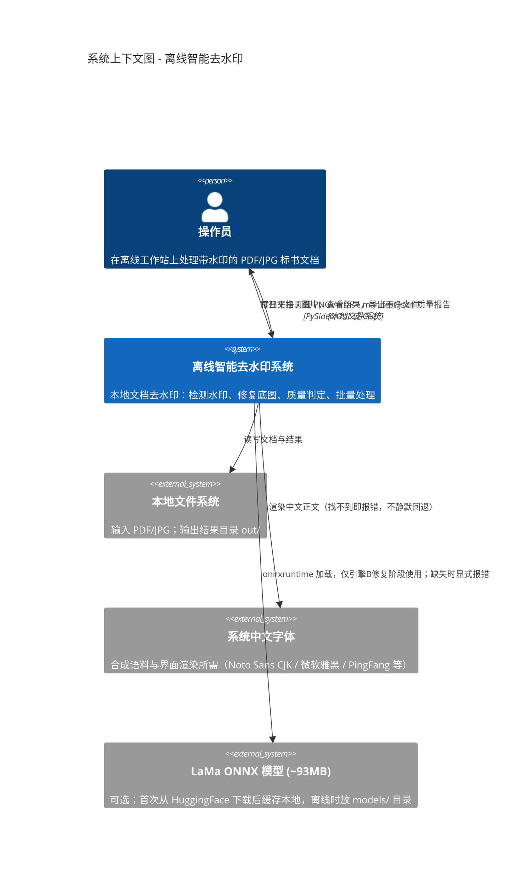
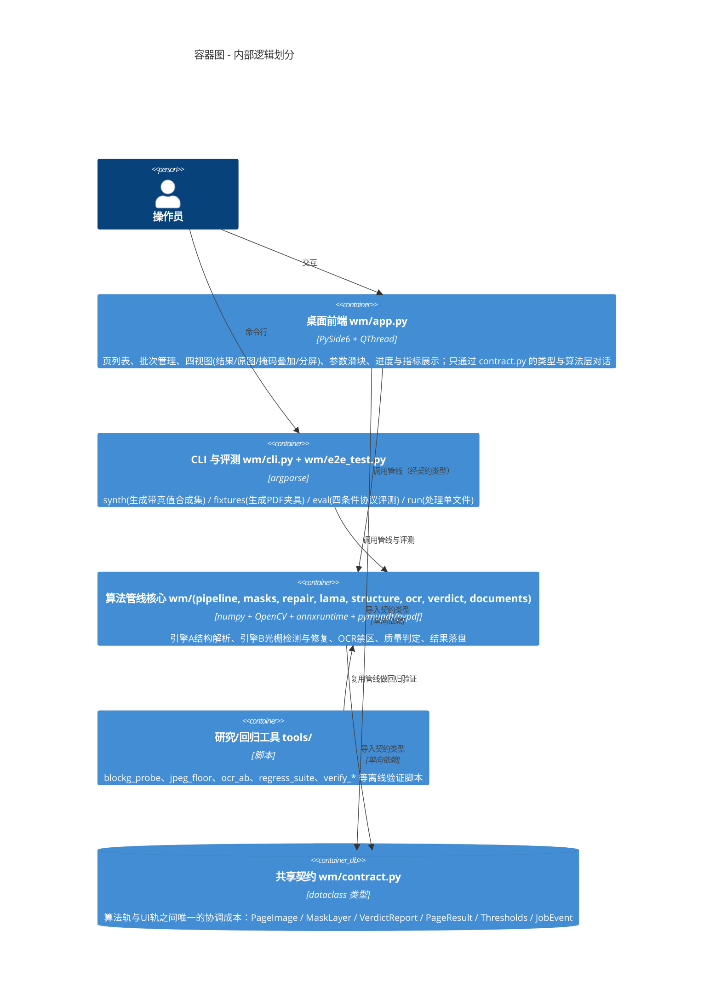
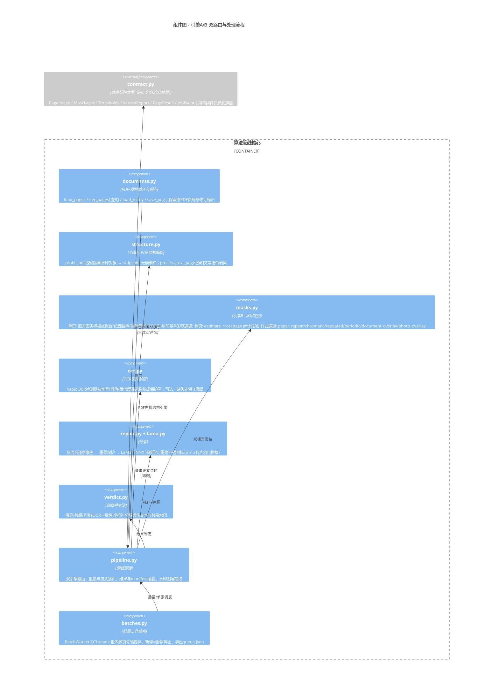
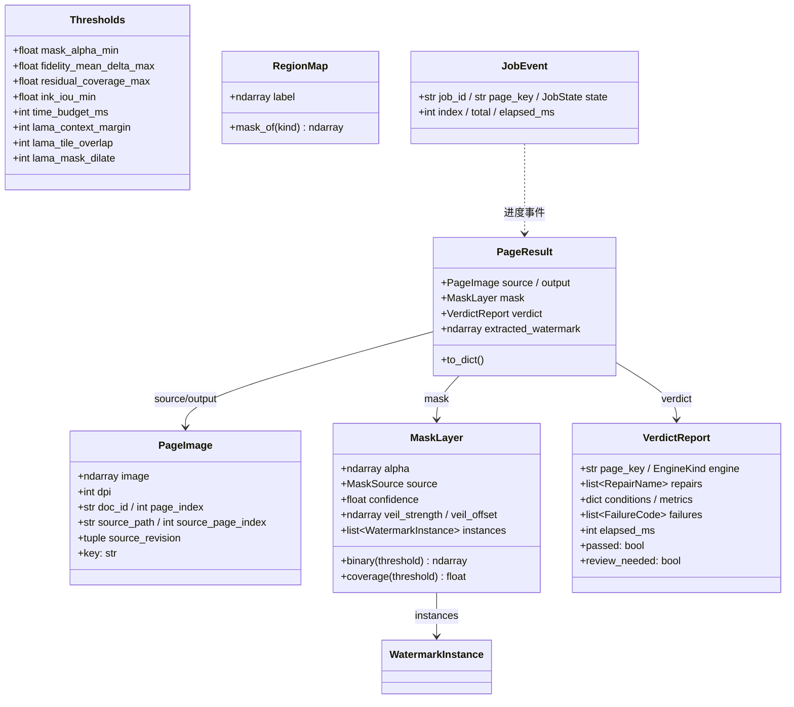

> 2026-10-26 数据退役说明：本文保留历史记录；旧 real_samples/syn 样本与旧复跑命令不再作为当前入口。当前使用 README.md 中的固定最小回归集，旧 16 组成绩不迁移为新集合成绩。

# offline-dewatermark-ai 项目说明（C4 架构视角）

> 本文档基于对仓库源码的完整走读生成，包含 **C4 模型四级架构图**（Mermaid 渲染）与 **编译 / 运行 / 部署说明**。
> 项目本身是一个**离线智能去水印原型**：在本地工作站上对 PDF / JPG 文档做水印检测与去除，支持单张与批量处理、桌面 GUI、以及可自证的合成数据评测协议。

---

## 1. 项目概览

| 项 | 内容 |
|---|---|
| 项目名 | offline-dewatermark-ai（离线智能去水印原型） |
| 语言 / 规模 | Python（约 7.2k 行），核心包 `wm/` + 开发工具 `tools/` + 测试 `tests/` |
| 形态 | 桌面应用（PySide6）+ CLI 工具 + 评测协议，全部本地离线运行 |
| 核心思路 | 叠印物理模型 `I = s·B + t`（`s=1-α₀`，`t=α₀W`）：水印定位后用代数反混合还原底色，不透明核心（水印压字区域）交给 LaMa 深度学习修复 |
| 双引擎 | **引擎A（结构解析）**：对 PDF 中独立的透明水印对象做无损删除；**引擎B（光栅分析）**：对像素做检测 + 修复 |
| 关键约束 | 离线工作站部署；时限标书 <2 分钟/张；宁可残留不可误伤正文（保真优先） |

---

## 2. C4 架构模型

### 2.1 Level 1 — System Context（系统上下文图）

系统的外部参与者只有**操作员**（离线工作站上的使用者），系统不与任何外部服务通信（LaMa 模型首次下载除外，属部署动作而非运行时依赖）。



### 2.2 Level 2 — Container（容器图）

单体 Python 应用，内部分四个逻辑容器：桌面 GUI、CLI/评测入口、算法管线核心、支撑工具。全部进程内运行，无网络服务。



### 2.3 Level 3 — Component（组件图）

算法管线核心内部的双引擎路由与检测-修复-判定流程：



**数据流（一次处理的实际顺序）：**

```
输入文件 ──► documents 载入 ──► structure 探测（PDF 且命中 → 无损删除，结束）
                                   │ 未命中
                                   ▼
                    masks 定位（单页检测；≥2页同尺寸时叠加跨页先验）
                                   │（OCR 提供正文禁区，全程保护）
                                   ▼
                    repair 修复 = alpha 反混合(纸面) → 墨晕保护 → LaMa(压字核心)
                                   │
                                   ▼
                    verdict 四条件判定 ──► write_results: 干净页PNG + 水印PNG + manifest.json
```

### 2.4 Level 4 — Code（代码层：核心类关系）



**关键枚举**（`contract.py`）：`EngineKind{STRUCTURE, RASTER}`（双引擎）、`MaskSource{STRUCTURE, CROSSPAGE, PRIOR, MODEL, HUMAN}`（掩码来源五档）、`RepairName{ALPHA_UNMIX, INPAINT, PAPER_CLEANUP, LAMA, DIFFUSION, NONE}`、`FailureCode`（8 种失败码）、`JobState`（queued/running/passed/failed/skipped/needs_review）。

---

## 3. 编译与运行说明

本项目是**纯 Python 解释执行**，无编译步骤；"编译"= 创建虚拟环境并安装依赖。

### 3.1 环境要求

| 项 | 要求 |
|---|---|
| Python | 实测 **3.14.6**（3.11/3.12 可用宽松清单降级，但须重跑 eval 对表） |
| OS | Windows（默认实测机）/ Linux / macOS；无桌面环境可 `QT_QPA_PLATFORM=offscreen` 跑测试 |
| 中文字体 | **必需**：`WM_FONTS_DIR` 环境变量，或系统目录 `C:/Windows/Fonts`、`/usr/share/fonts`、`/Library/Fonts`、`/System/Library/Fonts`；找不到直接报错 |
| 网络 | 仅首次运行 LaMa 需要（下载 ~93MB ONNX）；之后纯离线 |

> **macOS x86_64（Intel Mac）实测补充（2026-10-25）**：requirements.lock 是 Windows/Python 3.14 机的 freeze，其中两个包在 Intel Mac 上无可用 wheel：`onnxruntime==1.31.0`（官方对 macOS x86_64 只发到 1.23.2）与 `pymupdf==2.0`（要求 Python ≥3.14）。可行组合：**Python 3.13 + `requirements.txt` + `onnxruntime==1.23.2`**（其余包按 requirements.txt 精确钉死）。代码不依赖 `pymupdf4llm`/`pymupdf_layout`（lock 里的开发机残留），Python 3.14 在 Intel Mac 上不可行（onnxruntime 无任何 cp314 x86_64 版本）。安装后须重跑 `eval` 对表验收（MIGRATION.md §5）。

### 3.2 安装（四条命令）

```bash
git clone https://github.com/jrh010806/offline-dewatermark-ai.git
cd offline-dewatermark-ai
python -m venv .venv
./.venv/bin/pip install -r requirements.lock     # Windows: .venv\Scripts\pip
```

依赖分组（`requirements.txt`）：

- **经典通道（纯 CPU）**：numpy 2.5.4、opencv-python 5.0.0.93、scikit-image、scipy、pymupdf、pypdf、pillow、PySide6 6.12.0
- **LaMa 深度学习修复**：onnxruntime 1.31.0 + huggingface_hub（**不需要 torch**）
- **OCR 正文禁区**：rapidocr-onnxruntime（模型 ~8MB 随 wheel 打包，离线可用）
- **GPU 加速（可选）**：`onnxruntime-gpu` + 环境变量 `WM_LAMA_CUDA=1`

装完自检：

```bash
python -c "import numpy, cv2, skimage, fitz, PySide6, PIL; print('依赖 OK')"
python -c "from wm.lama import is_available; print('LaMa:', '可用' if is_available() else '缺失')"
python -c "from wm import ocr; print('OCR:', '可用' if ocr.available() else '未装')"
```

### 3.3 运行方式

**① 合成评测基准（带真值，可自证）**

```bash
python -m wm.cli synth --out data/syn --docs 5 --pages 6   # 生成带真值语料（约1分钟/30页）
python -m wm.cli fixtures --data data/syn --out data/pdf  # 打成光栅PDF与结构水印PDF
python -m wm.cli eval --data data/syn                      # 四条件协议评测，出成功率表
```

> 判断环境装对了的唯一标准：`eval` 数字与项目记录一致（随机种子固定 20261019 → 语料逐像素一致 → 结果可复现）。

**② 处理单个文件**

```bash
python -m wm.cli run data/pdf/doc00_tiled_text/raster_flattened.pdf --out out/run
```

**③ 不依赖中文字体的端到端自测（纯 OpenCV 渲染，随时可跑）**

```bash
python -m wm.e2e_test --out out/e2e_ort     # 5 种样式，落盘 results.json
```

**④ 桌面 GUI（多批次处理）**

```bash
python -m wm.app [文件]      # 可加 --smoke 做离屏自检
```

支持：新增/重命名/删除批次、同批同尺寸组跨页先验、逐张进度、暂停/继续/停止、按批次导出（结果 + manifest + queue.json）。参数分 `mask` 类（改后需重新定位）与 `repair` 类（可复用先验）。

**⑤ 测试与回归**

```bash
QT_QPA_PLATFORM=offscreen python -m unittest discover -s tests -v   # 队列与界面回归
HF_HUB_OFFLINE=1 python tools/verify_single.py                      # 单图斜向文字验证
HF_HUB_OFFLINE=1 python tools/regress_suite.py --stage after        # 全量原尺寸回归
```

### 3.4 离线部署要点

1. **LaMa 模型**：有网机器先跑一次自动下载缓存到 `~/.cache/huggingface/`；离线机拷贝到以下任一位置：
   - `~/.cache/huggingface/`
   - 项目根目录 `models/inpainting_lama_2025jan.onnx`
   - 环境变量 `WM_LAMA_ONNX=/path/to/model.onnx`
   - **缺失策略：显式抛 `LamaModelMissing`，绝不静默回退到 cv2.inpaint**
2. **OCR 模型**：随 rapidocr wheel 打包，无需下载；未装时 `text_zones()` 返回 None，检测走保守阈值，管线不中断。
3. **Linux 无桌面**：`QT_QPA_PLATFORM=offscreen` 可跑测试，但离屏平台无 CJK 字体，截图中文变方框属 Qt 正常行为。
4. **已知遗留**：`pymupdf` 为 AGPL-3.0，闭源交付需替换为 `pypdfium2`（BSD）并重跑 eval/fixtures。

### 3.5 目录与产物

| 目录 | 说明 | 在 git？ |
|---|---|---|
| `wm/` `tools/` `tests/` | 源码、工具、测试 | ✅ |
| `data/` | 合成语料、PDF 夹具（可再生，种子固定） | ❌ 生成 |
| `out/` | 处理结果（PNG + manifest.json） | ❌ 生成 |
| `models/` | LaMa ONNX 权重 | ❌ 首启下载或手工放置 |
| `docs/` | 需求分析/投标策略 | ❌ 故意不入库 |

---

## 4. 技术要点速览

- **叠印模型**：`I = s·B + t`。文档双极性给出两个可观测极点（被覆盖纸面 `s·P+t`、被覆盖墨 `t`），由 `α₀(P−W)=m` 绑定强度与颜色，只剩一个自由参数，用打分搜索确定；极点必须用直方图**尖峰**定位（抗锯齿会把分位数拖偏到文字裙边）。
- **两条保护性规则**：① 半透明叠加只有在同窗口内还存在未覆盖纸面时才"可验证"（照片渐变无水印锚点）；② 真实墨旁像素优先归文字（83–91% 假阳性落在墨笔画 3–5px 内）。
- **判定协议**（自研，需求方未给公式）：掩码质量 / 保真 / 残膜 / OCR 识别一致性 / 时限（120s/页）。无真值时 `review_needed=true`，不计入 success_rate。
- **当前状态**（README 2026-10-21）：经典通道 CPU 端到端打通；合成集掩码精确率 dot_grid 0.97 / tiled_text 0.90，整页 PSNR 33–41；LaMa 已接入，5 样式单页 13.3–29.4s；深色重字母水印与极小角标仍不可辨识。
